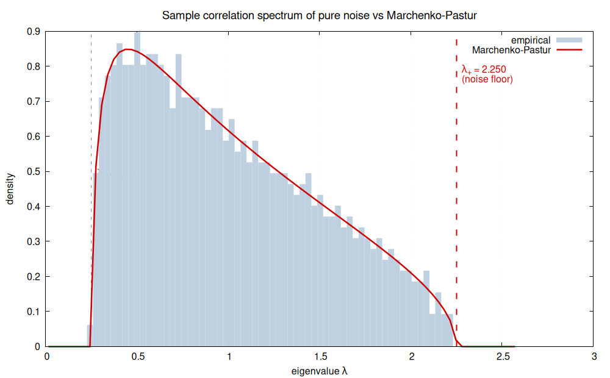
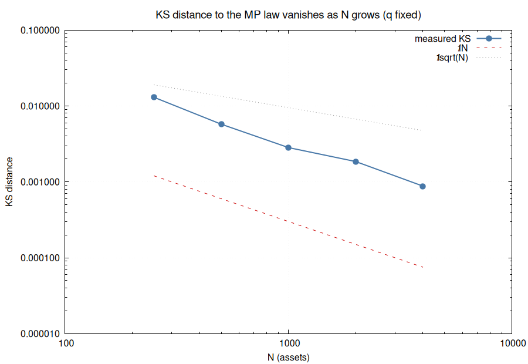
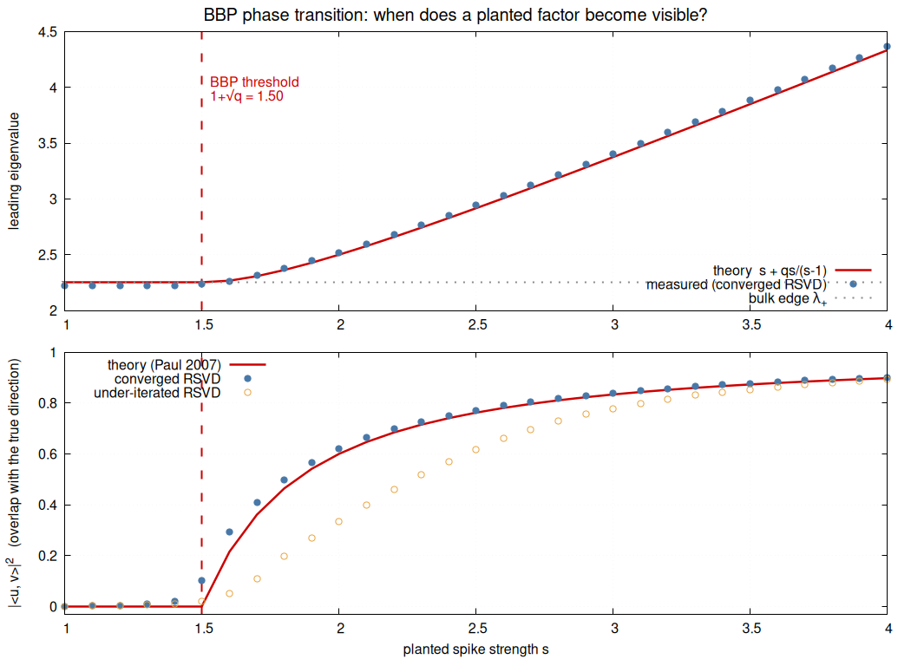
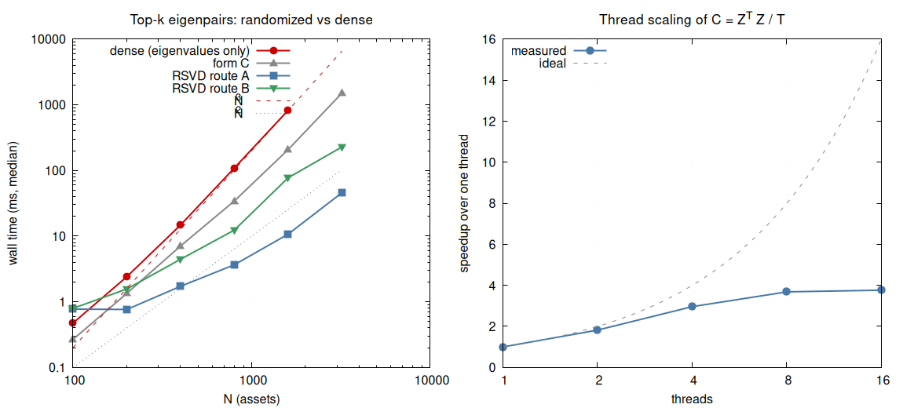

# Randomized SVD of a financial correlation matrix, validated against Marchenko–Pastur

A self-contained C++20 implementation, with no mandatory dependencies, of
randomized low-rank eigendecomposition for sample correlation matrices —
together with the random-matrix theory that tells you where to truncate and
proves that what you discarded was noise.

---

## 1. The problem

A sample correlation matrix built from `T` observations of `N` assets is mostly
noise. When `T` is not vastly larger than `N`, most of its eigenvalues are pure
estimation error: they follow the Marchenko–Pastur law even when the true
correlation is the identity. Only a handful — a market mode and a few sector
modes — carry signal.

Yet a full eigendecomposition costs **O(N³)** and spends nearly all of it
resolving the noise.

The two halves of this project fit together:

- **Randomized SVD** extracts the top-`k` subspace in **O(N²k)**.
- **Marchenko–Pastur** says what `k` should be, and certifies the remainder.

RSVD needs a rank; MP supplies it. MP needs the signal eigenvalues; RSVD
supplies them cheaply. Neither half is novel; the point is that together they
are *self-validating* at sizes where no reference decomposition is affordable.

---

## 2. The mathematics

### 2.1 From returns to a correlation matrix

Start from returns `X` of shape `T × N`. Standardize each column to zero mean
and unit variance → `Z`, then

```
C = Zᵀ Z / T          (N × N, symmetric PSD, trace exactly N)
```

The normalization is fixed throughout: **population** standard deviation
(`1/T`, not `1/(T−1)`). The MP edges below are stated for exactly this
convention, and mixing in a `1/(T−1)` somewhere shifts the noise floor and
quietly invalidates every comparison downstream. `tr(C) = N` exactly is used as
a conservation law later, so `correlation_matrix` pins the diagonal to 1 rather
than letting rounding accumulate there.

### 2.2 The Marchenko–Pastur law

If the columns of `Z` were i.i.d. noise — the true correlation *is* the identity
— then with aspect ratio `q = N/T`, as `N, T → ∞` the eigenvalue density of `C`
converges to

```
ρ(λ) = √((λ₊ − λ)(λ − λ₋)) / (2π q λ)       on [λ₋, λ₊]
λ±  = σ²(1 ± √q)²
```

with an additional atom at zero of mass `1 − 1/q` when `q > 1`.

**`λ₊` is the noise floor.** An eigenvalue inside `[λ₋, λ₊]` is statistically
indistinguishable from estimation error. The counter-intuitive part is that the
eigenvalues of pure noise do *not* cluster at 1 — they spread over a wide bulk
whose edges are predicted exactly.

Anchor case used throughout: `N = 1000`, `T = 4000` → `q = 0.25`, so
`λ₋ = 0.25` and `λ₊ = 2.25`.

**Evaluating the CDF.** The density has inverse-square-root singularities at
both edges, which defeats naive quadrature. Substituting

```
λ = λ₋ + 4√q · sin²θ          (note λ₊ − λ₋ = 4√q)
```

cancels both exactly and leaves

```
F(λ(θ₁)) = ∫₀^θ₁ 4 sin²(2θ) / (π λ(θ)) dθ
```

which is smooth, so fixed-order Gauss–Legendre reaches machine precision.
`θ₁ = π/2` must return exactly `min(1, 1/q)`, which is a free unit test and is
checked for `q` from 0.02 to 4.

**Self-consistent σ².** Fitting the bulk with `σ² = 1` overestimates the floor,
because the market mode absorbs a large share of the total variance and leaves
the bulk narrower than the naive law predicts. So iterate: given `k` signal
modes, the variance left for the bulk is `(tr(C) − Σ_{i≤k} λᵢ)` spread over the
remaining `N − k` modes; recompute the cut from that and recount. Two or three
passes converge. This is the Laloux–Cizeau–Bouchaud–Potters procedure — and it
has a failure mode, discussed in §5.5.

### 2.3 Randomized SVD, specialized to a symmetric PSD matrix

The Halko–Martinsson–Tropp range finder, finished with Rayleigh–Ritz:

```
ℓ = k + p                                 (p = oversampling, default 10)
Ω ~ N(0,1)^{N×ℓ}
Y = C Ω ;  Q = orth(Y)
repeat `it` times:  Y = C Q ;  Q = orth(Y)
M = Qᵀ (C Q) ;  M ← (M + Mᵀ)/2
(V, Λ) = syev(M) ;  U = Q V
```

Three details that matter and are easy to get wrong:

- **Re-orthonormalize after every application of `C`.** With a geometrically
  decaying spectrum, skipping the intermediate QR costs roughly `log₁₀(κ)`
  digits per step and the sketch collapses onto the single dominant direction.
- **Symmetrize `M` explicitly.** `Qᵀ(CQ)` is not bit-symmetric; feeding an
  asymmetric matrix to a symmetric eigensolver gives silently wrong
  eigenvectors.
- **Rayleigh–Ritz, not the `B = QᵀA` SVD route.** For symmetric `A` the SVD
  returns `|λ|` and loses sign information; RR returns real eigenpairs by
  construction and costs fewer flops.

**Two routes.** Route A sketches `C` directly. Route B sketches `Z` and never
forms `C`:

```
Ω ~ N(0,1)^{N×ℓ};  Y = Zᵀ(Z Ω);  Q = orth(Y)
repeat:            Y = Zᵀ(Z Q);  Q = orth(Y)
M = (ZQ)ᵀ(ZQ) / T  ≡  Qᵀ C Q
```

`Zᵀ(Zv)` is the same operator as `Cv` up to the `1/T`, which does not change
the column space — so with the same seed both routes compute the same answer by
different arithmetic. That agreement is checked at every benchmark size (§4.3)
and is a genuine correctness test, not a formality. Route B is preferred when
`N` is large: it avoids the `N²T` cost of building `C`, and forming `C` squares
the condition number of exactly the part we care about.

### 2.4 Why the cut is *right*, not merely convenient — BBP

Plant `r` factors so the population covariance is `Σ = I + Σⱼ (sⱼ − 1) vⱼ vⱼᵀ`.
Baik–Ben Arous–Péché: the sample spectrum undergoes a phase transition at

```
s_crit = 1 + √q        (= 1.5 for q = 0.25)
```

- **above it** — the sample eigenvalue separates from the bulk, landing at
  `s + qs/(s−1)`, and the sample eigenvector keeps a non-vanishing overlap with
  the truth, `|⟨û,v⟩|² → (1 − q/(s−1)²)/(1 + q/(s−1))` (Paul 2007);
- **below it** — the eigenvalue is swallowed by the bulk and the eigenvector
  decorrelates entirely.

So below the threshold **no algorithm recovers the factor from the sample**.
Cutting at `λ₊` discards nothing that could have been kept, and RSVD gives up
nothing by stopping there. That is the argument the whole project rests on, and
§4.2 measures it.

---

## 3. What the code does

| Module | Contents |
|---|---|
| `matrix.hpp` | column-major, 64-byte-aligned storage, composable views |
| `householder.hpp` | reflector generation, left application, symmetric rank-2 similarity |
| `qr.hpp` / `qr.cpp` | Householder QR, thin-Q formation, `orthonormalize` |
| `syev.hpp` / `syev.cpp` | tridiagonalization + implicit-shift QL; values-only mode |
| `gemm.hpp` / `gemm.cpp` | naive oracle + packed AVX2 threaded GEMM and SYRK |
| `threadpool.hpp` | persistent `std::thread` pool, `parallel_invoke` |
| `rng.hpp` | explicit Box–Muller; reproducible from `(seed, length)` alone |
| `quadrature.hpp` | Gauss–Legendre nodes and weights |
| `stats.hpp` / `stats.cpp` | standardization, correlation, trace, IPR |
| `mp.hpp` / `mp.cpp` | MP density/CDF, KS test, self-consistent floor, trace check |
| `rsvd.hpp` / `rsvd.cpp` | routes A and B, Rayleigh–Ritz, flop counts |
| `diagnostics.hpp` | residuals, principal angles, a posteriori error estimate |
| `spiked.hpp` / `spiked.cpp` | spiked-covariance generator, BBP and overlap laws |
| `csv.hpp` / `csv.cpp` | returns reader with strict validation, table writers |

Four apps: `rnf_mp_null`, `rnf_spiked`, `rnf_bench`, `rnf_analyze`.
Ten test suites, ~700 assertions, run by `ctest`.

**Dependencies: none required.** Everything numerical is written here — GEMM,
QR, the eigensolver, the RNG, the quadrature. Two optional CMake switches exist
and neither is needed to build or run: `RNF_USE_BOOST_MATH` (cross-checks our
statistics against Boost.Math) and `RNF_USE_OPENBLAS` (a benchmark-only
comparison against vendor BLAS).

---

## 4. Results

### 4.1 The noise floor is real and correctly placed



Pure i.i.d. Gaussian returns, `N = 1000`, `T = 4000`. The empirical spectrum
lands on the MP density; `tr(C) = 1000.0000000000` exactly; **100% of the 1000
eigenvalues fall inside the predicted bulk `[0.25, 2.25]`**.

MP is an *asymptotic* law, so a single `N` proves nothing. Holding `q` fixed and
growing `N`:

| N | T | KS distance | λ_max | λ₊ |
|---:|---:|---:|---:|---:|
| 250 | 1000 | 0.012989 | 2.2144 | 2.25 |
| 500 | 2000 | 0.005743 | 2.1978 | 2.25 |
| 1000 | 4000 | 0.002826 | 2.2463 | 2.25 |
| 2000 | 8000 | 0.001850 | 2.2385 | 2.25 |
| 4000 | 16000 | 0.000878 | 2.2404 | 2.25 |



KS falls by 14.8× over a 16× increase in `N` — close to `1/N`, faster than the
`1/√N` a naive reading would suggest.

Note that `λ_max` sits consistently *below* `λ₊`, not above. That is correct:
the largest bulk eigenvalue fluctuates about the edge on a scale `N^(−2/3)`
following a Tracy–Widom law whose mean is negative. An earlier expectation that
it would sit a few percent *above* the edge was simply wrong.

### 4.2 Factors are recovered exactly down to the BBP threshold



A single planted factor, strength walked from 1.0 to 4.0 at `q = 0.25`. The
transition at `1 + √q = 1.5` is sharp. Above it, both the eigenvalue and the
eigenvector overlap track theory closely; below it the eigenvalue is pinned to
the bulk edge and the overlap is zero.

The orange series is the same computation with too few power iterations, and it
is the practical lesson of the figure — see §5.4.

**Trace conservation.** With four factors planted at `N = 1000`:

```
tr(C)            = 1000.000000   (exactly N)
retained by top-4=   38.294406
discarded mass   =  961.705594
implied sigma^2  =    0.965568
implied lambda+  =    2.172528
lambda_{k+1}     =    2.147461
headroom         =   +0.025067  -> remainder IS consistent with MP noise
```

The bulk is never computed. The discarded mass is known exactly because
`tr(C) = N`, which is what makes the check affordable at any size.

### 4.3 Randomized beats dense, and the gap widens



`k = 20`, `p = 10`, `it = 2`, `q = 0.25`, median of 3 runs. Dense baseline is
**eigenvalues only** — the cheapest way to get a full spectrum — so the speedups
are conservative; RSVD also returns eigenvectors.

| N | T | form C (ms) | RSVD A (ms) | RSVD B (ms) | dense (ms) | A vs dense | A/B agreement |
|---:|---:|---:|---:|---:|---:|---:|---:|
| 100 | 400 | 0.27 | 0.77 | 0.79 | 0.5 | 0.6× | 1.5e-15 |
| 200 | 800 | 1.34 | 0.76 | 1.57 | 2 | 3.2× | 1.6e-15 |
| 400 | 1600 | 7.08 | 1.72 | 4.44 | 15 | 8.6× | 1.0e-15 |
| 800 | 3200 | 34.26 | 3.66 | 12.36 | 109 | 29.8× | 1.2e-15 |
| 1600 | 6400 | 207.61 | 10.71 | 77.29 | 823 | **76.9×** | 2.4e-15 |
| 3200 | 12800 | 1503.26 | 45.71 | 227.78 | — | — | 2.4e-15 |

- **Crossover is around N ≈ 150.** Below it the dense solver wins; above it the
  advantage grows roughly linearly, as `O(N³)` versus `O(N²k)` predicts.
- **Routes A and B agree to ~2e-15 at every size.** They compute the same thing
  by materially different arithmetic, so this is real evidence of correctness.
- **Route B's advantage is end-to-end.** Starting from returns, route A must pay
  `form C`: at `N = 3200` that is `1503 + 46 = 1549 ms` against route B's
  `228 ms`, a **6.8×** difference that the per-call columns hide.

### 4.4 Kernel throughput

| shape | naive (ms) | packed (ms) | GFLOP/s | speedup |
|---|---:|---:|---:|---:|
| 512³ square | 313.2 | 4.16 | 64.6 | 75× |
| 2000×30×2000 (RSVD's shape) | 293.7 | 2.33 | **103.1** | **126×** |

Building `C` at `N = 1000, T = 4000` went from **1208 ms to 192 ms** when the
packed kernel replaced the scalar one, with the KS statistic and bulk edges
bit-identical before and after.

Thread scaling of `C = ZᵀZ/T` at `N = 1500` (Intel Core 7 240H, 10 physical
cores / 16 threads):

| threads | ms | GFLOP/s | speedup | efficiency |
|---:|---:|---:|---:|---:|
| 1 | 647.6 | 20.9 | 1.00× | 100% |
| 2 | 356.1 | 37.9 | 1.82× | 91% |
| 4 | 212.1 | 63.7 | 3.05× | 76% |
| 8 | 170.3 | 79.3 | 3.80× | 48% |
| 16 | 193.9 | 69.7 | 3.34× | 21% |

Sixteen threads is *worse* than eight. This is a hybrid P-core/E-core CPU with
hyperthreading; for a compute-bound FMA kernel the second thread per physical
core contends rather than helps. Eight is the right setting on this machine,
and `ThreadPool::resize_global` exists so a caller can choose. See §5.3 for the
two scheduling bugs that had to be fixed before this curve was even monotone.

### 4.5 A real returns panel

`rnf_analyze` on `data/sample_returns.csv` (1250 days × 80 synthetic assets,
`q = 0.064`), using route B so `C` is never formed:

```
  rank   eigenvalue       %var    margin        1/IPR          kind
     1      32.6400     40.80%    20.79x         74.5    delocalized
     2       3.0644      3.83%     1.95x         34.5          mixed
     3       2.9020      3.63%     1.85x         62.1    delocalized
     4       2.4370      3.05%     1.55x         32.7          mixed
```

The inverse participation ratio separates the two kinds of factor by
inspection: `1/IPR ≈ 74` of 80 names for the leading mode (it loads a little on
everything — the market), against `≈ 33` for the concentrated ones. The top mode
alone carries 41% of total variance; everything below the cut is discarded, and
§2.4 is the argument that nothing recoverable went with it.

---

## 5. Things that were not obvious

These cost real debugging time and are the most useful part of the write-up.

### 5.1 A quadrature rule can be exact on your tests and still wrong

An off-by-one in the Legendre recurrence produced the roots of `P_{n−1}` while
the weights assumed `P_n`. Every polynomial test passed — a 63-point rule still
integrates `x¹¹` exactly — but the MP mass came out 0.3% low. The test that
catches it asserts the *order*: an `n`-point rule is exact to degree `2n−1` and
**must fail** at `2n`. Testing correctness on easy inputs is not the same as
testing the property you depend on.

### 5.2 The obvious way to measure a subspace angle cannot measure small ones

`sin θ_max = √(1 − cos²θ_min)` via the singular values of `U_refᵀ U_got` bottoms
out at `√ε ≈ 1.5e-8`: for a converged subspace `cos²` is within rounding of 1,
and the subtraction cancels catastrophically. The Björck–Golub sine form,

```
sin θ_max = ‖(I − U_ref U_refᵀ) U_got‖₂
```

projects first and measures the residual, keeping full precision. Switching to
it changed a measured angle from a floor of `4.7e-8` to a true `1.4e-9`.

### 5.3 Static scheduling is wrong on a hybrid CPU

The first threaded GEMM scaled to 2.8× on 4 threads and then got *worse*, with a
pronounced dip at 8. Two causes:

- **Granularity.** Work was split over `MC = 192`-row blocks. At `N = 1500` that
  is 8 blocks, so half a 16-thread pool was handed nothing at all.
- **Per-call allocation.** Each `parallel_for` gave every worker a fresh ~400 KB
  packing buffer; a single correlation build issues dozens of blocked passes.

Fixing both — `thread_local` grow-only scratch, and workers pulling row blocks
from an atomic counter instead of receiving equal slices — made the curve
monotone. Equal static chunks are paced by the slowest core, and on a hybrid
P/E-core part the cores are not equal. A third fix, narrowing SYRK's column
strips from 1024 to 256 so the triangular skip actually bites, recovered another
25%.

### 5.4 Statistical marginality and numerical difficulty have the same cause

A spike near the BBP threshold sits just above the bulk edge *by construction*.
Randomized subspace iteration converges at a rate set by exactly that gap — so
the factors that are hardest to believe in are also the ones that need the most
power iterations. At `it = 3` RSVD systematically **undershoots** both the
eigenvalue and the eigenvector overlap (the orange series in §4.2); at `it = 30`
it matches the dense solver to 1e-5.

The trap is that under-iterating looks exactly like a weak factor. If you do not
spend the iterations you will mistake slow convergence for absent signal.

### 5.5 The self-consistent floor can run away

The fitted `σ²` is what makes the method self-contained: it estimates the bulk
variance from the trace left after removing the signal, which is the only thing
available when the bulk is never computed. But that makes it a fixed point with
a failure mode — absorbing one bulk eigenvalue lowers `σ²`, which lowers the
cut, which absorbs the next.

On the 80-asset panel the fitted cut accepts **13** factors to the naive cut's
**4**, and the data has about 4. At `N = 80` the edge fluctuation is `N^(−2/3) ≈
5%`, comparable to the spacing near the edge, so the iteration cascades.

Note also that the trace-conservation check does *not* catch this: when `k` came
from the same fit, `λ_{k+1}` sits just below the implied floor **by
construction**. It is a genuine check of a rank chosen independently, not of the
fit that produced it.

`rnf_analyze` therefore reports both cuts, a per-factor margin, and a warning
when they disagree badly. The principled fix is a Tracy–Widom threshold, which
replaces the judgement call with a p-value — see §7.

### 5.6 Two modelling traps worth stating plainly

**BBP is a covariance result.** Standardizing to a *correlation* matrix divides
each asset by a standard deviation that the spikes themselves inflated, so
correlation eigenvalues come out systematically below the raw BBP prediction —
by roughly `N / tr(Σ)`. With four strong spikes, the sample covariance spectrum
matched BBP to three digits (25.256 vs 25.260 predicted) while the correlation
spectrum gave 22.167. Easy to mistake for a broken solver.

**Collinear loadings lose a factor.** If sectors partition the universe *and*
every name shares one market beta, the market's loading vector is exactly the
sum of the sector indicators: the loading matrix has rank (sectors), not
(sectors + 1), and one fewer eigenvalue separates from the bulk than you
planted. Dispersed betas and partial sector coverage fix it — and both are what
real markets look like anyway.

---

## 6. Running it

```bash
cmake -B build -DCMAKE_BUILD_TYPE=Release && cmake --build build -j
```

```bash
ctest --test-dir build --output-on-failure
```

Validate the noise floor against the i.i.d. null, and watch KS shrink with `N`:

```bash
./build/rnf_mp_null --N 1000 --T 4000 --sweep 250,500,1000,2000 && gnuplot plots/mp_overlay.gnuplot && gnuplot plots/ks_convergence.gnuplot
```

Recover planted factors and map the BBP threshold:

```bash
./build/rnf_spiked --N 1000 --T 4000 --sweep-spike 1.0:4.0:0.1 --trials 3 && gnuplot -e "scrit=1.5; lplus=2.25" plots/bbp.gnuplot
```

Benchmark randomized against dense:

```bash
./build/rnf_bench --sizes 100,200,400,800,1600,3200 --dense-max 1600 && gnuplot plots/bench.gnuplot
```

Analyze a returns file:

```bash
./build/rnf_analyze --csv data/sample_returns.csv --floor naive
```

Every app takes `--help`. Every result is reproducible from its `--seed`.

### End-to-end check

The single comparison that exercises the whole chain: at `N = 1000, T = 4000`
with four factors planted, compute the spectrum *both* ways and confirm that
the signal eigenvalues agree and that the discarded mass matches the bulk.

```
  dense (values+vectors) 640 ms   vs   RSVD route B 92 ms   (7x)
  max relative eigenvalue error vs dense : 3.615e-09
  sin(theta_max) between subspaces       : 9.901e-05
  factors found by the MP cut            : 4  (planted 4)
  trace: tr(C)=1000.000000  discarded=943.6739  sigma^2=0.947464
  lambda_{k+1}=2.121730 vs implied floor 2.131794 -> consistent with MP noise
  discarded mass vs TRUE bulk sum        : 943.673936 vs 943.673935 (rel 1.20e-11)
```

The last line is the one that matters. `tr(C) = N` lets RSVD state the
discarded mass **exactly, without ever computing the bulk** — and here, where
the bulk happens to be available for comparison, the two agree to 1.2e-11.
That is what makes the method self-validating at sizes where no dense
reference exists.

Two caveats visible in the same output. The comparison covers only the four
modes that cleared the floor; ranks beyond it reach into the bulk, where the
invariant subspace is not well defined and a large discrepancy against the
dense solver is the *correct* answer (§5.4). And `sin θ_max ≈ 1e-4` rather than
1e-9 because the weakest planted factor sits close to the edge — again §5.4,
not a defect.

---

## 7. Limitations and what is next

- **No Tracy–Widom thresholding.** This is the most valuable missing piece:
  §5.5 shows the hard `λ₊` cut is unreliable at small `N`, and a TW null
  distribution for `λ_max` would give each candidate factor a p-value instead of
  a yes/no. Deliberately out of scope here; §5.5 is the concrete motivation.
- **No eigenvalue clipping / risk backtest.** The natural payoff — clip the bulk
  to its mean, rebuild a cleaned correlation matrix, and compare out-of-sample
  minimum-variance portfolio risk against the raw matrix — is not implemented.
- **Gaussian sketches only.** Structured sketches (SRFT / subsampled randomized
  Hadamard) would cut the sketch cost from `O(N²k)` to `O(N² log k)`, though
  with a BLAS3 GEMM this rarely wins in practice.
- **Thread count is not auto-tuned.** `hardware_concurrency()` over-subscribes on
  this hybrid part (§4.4); eight threads is better than sixteen and nothing
  detects that automatically.
- **The dense eigensolver is unblocked.** `tred2`/`tql2` at `N = 4000` takes
  ~19 s. It is a reference implementation, not a competitor to LAPACK, and the
  values-only path exists precisely so the MP sweeps do not pay for eigenvectors
  they never use.

---

## 8. References

- Marchenko & Pastur (1967), *Distribution of eigenvalues for some sets of random matrices*.
- Laloux, Cizeau, Bouchaud & Potters (1999), *Noise dressing of financial correlation matrices*.
- Baik, Ben Arous & Péché (2005), *Phase transition of the largest eigenvalue for non-null complex sample covariance matrices*.
- Paul (2007), *Asymptotics of sample eigenstructure for a large dimensional spiked covariance model*.
- Halko, Martinsson & Tropp (2011), *Finding structure with randomness*.
- Björck & Golub (1973), *Numerical methods for computing angles between linear subspaces*.
